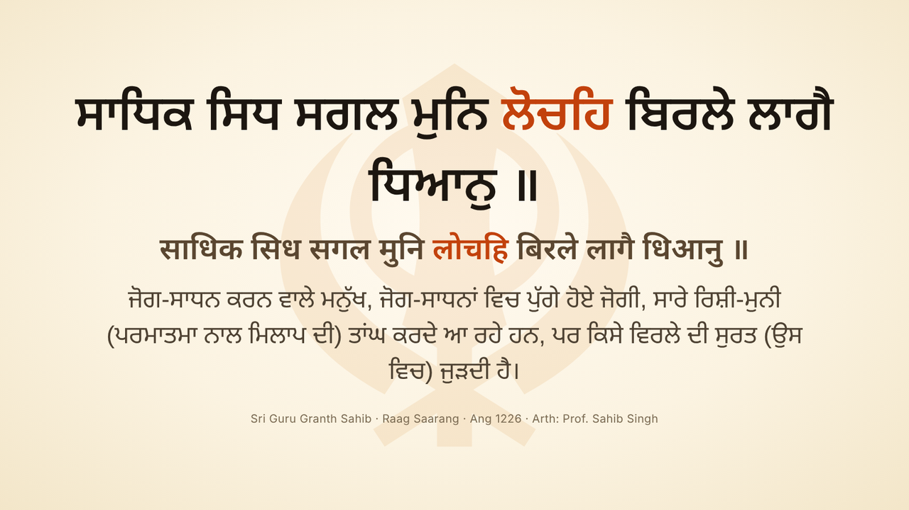
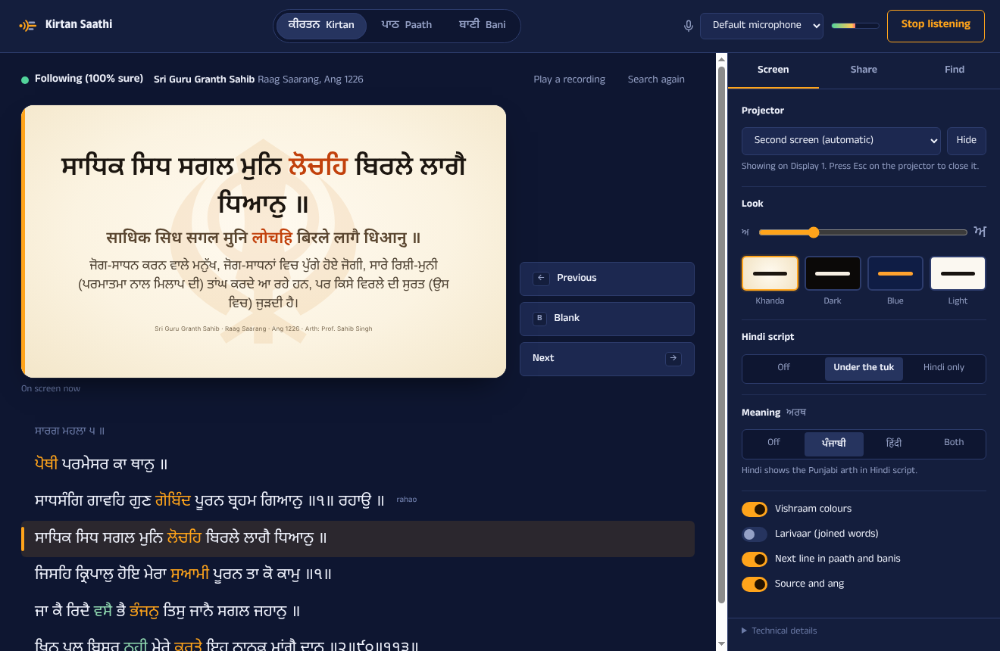
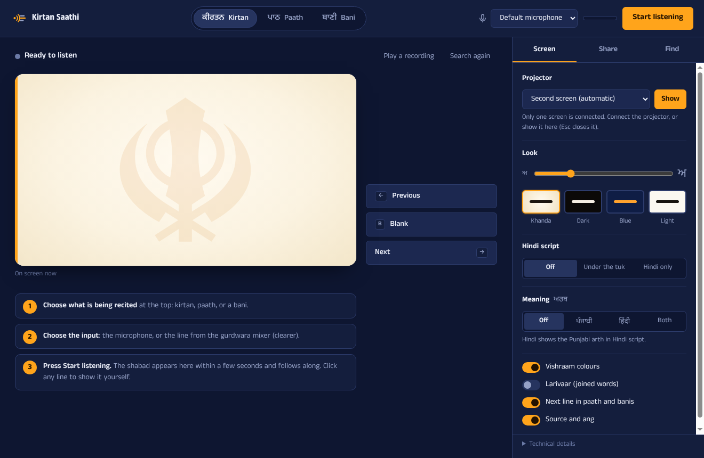
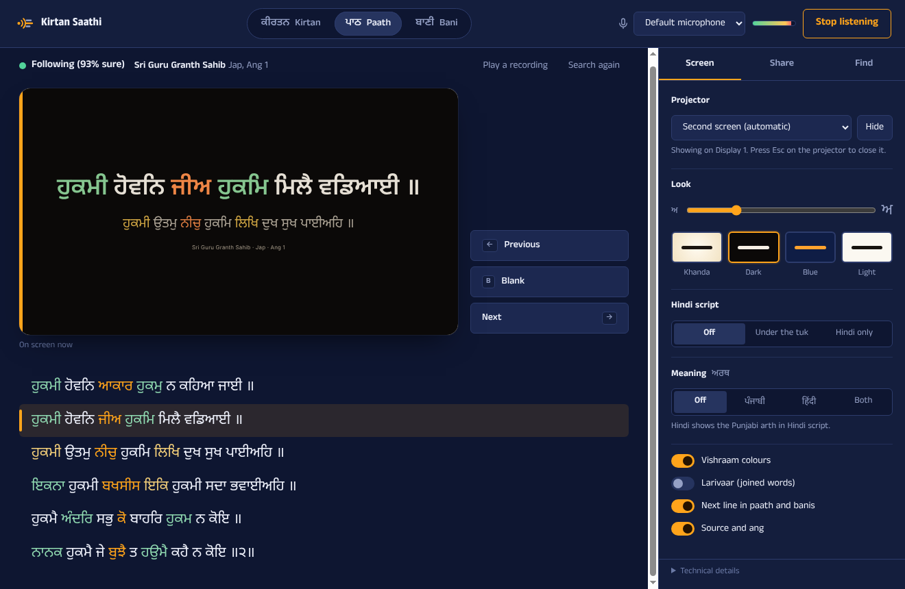
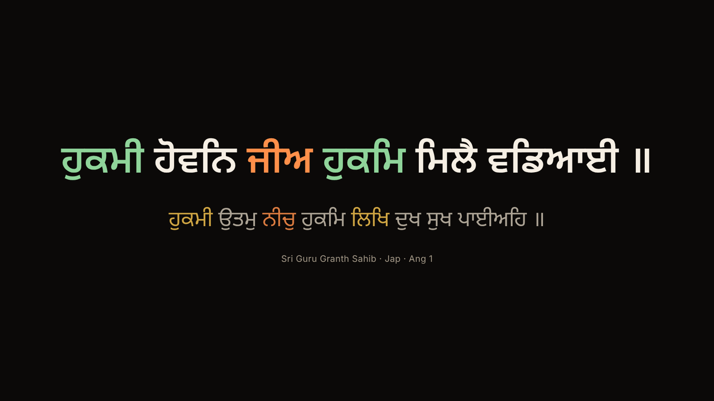
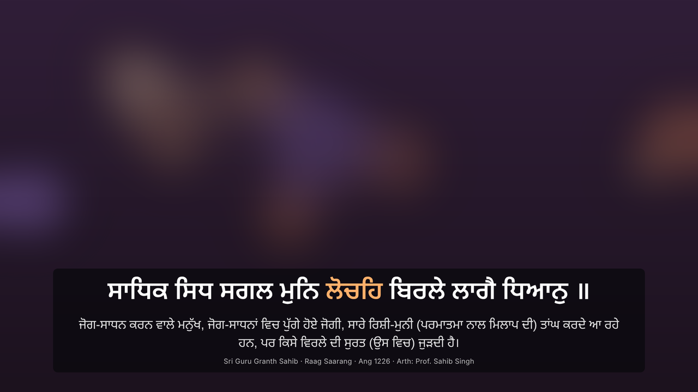
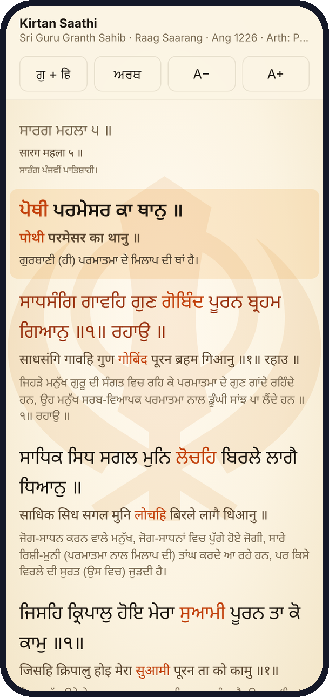

# Kirtan Saathi



Offline desktop app (Electron, Windows + macOS) that listens to a microphone, works out which Gurbani is being sung or recited, and shows the current tuk. It handles three situations:

| Mode | For | What it does |
|---|---|---|
| **Kirtan** | Sung shabads | Identifies the shabad from the whole corpus, then tracks the line through repeats and returns to the rahao |
| **Paath** | Sehaj or akhand paath | Finds the position, then follows recitation forward through the source, across shabad boundaries |
| **Bani** | Nitnem and other banis | Follows a chosen bani (Japji, Jaap, Rehras, Sohila, Anand, Sukhmani and others; 29 in total) |

Everything runs on the CPU with no network access at runtime. Only canonical Gurbani text is ever displayed; the recognizer's own transcript is used for matching only.

Status: Phase 3. The engine handles kirtan, paath and bani modes. Outputs are a projector window, an OBS livestream overlay and a phone follow page. Optional Hindi script and Punjabi meanings can be shown under the tuk. Installers are built and tested in CI.

## What it looks like

### The operator window

The sevadar runs everything from one window. The live preview shows exactly what the sangat sees. The shabad below follows the singer; click any line to show it.



On first start, three numbered steps explain what to do.



In paath mode the app follows the reading line by line, across shabads, and previews the next line.



### Projector

The default theme is *Light with Khanda*. Optional extras under the tuk:

- **Hindi script:** the tuk in Devanagari.
- **Meaning:** Punjabi arth, in Gurmukhi and/or Hindi script.

The source line shows the scripture, raag, ang and whose arth is shown, but not the author's name. Vishraam points are coloured.

The dark theme, with the next line previewed during paath:



### Livestream overlay

The overlay is a transparent lower third for OBS. Add it as a *Browser* source; it sits on top of the video.



### Phones

The sangat can follow the whole shabad on their phones over the gurdwara Wi-Fi. The live line is highlighted. Each reader picks Gurmukhi or Hindi script, meanings and text size on their own phone.



## Download

Get the installer for your computer from the [Releases page](https://github.com/sethigoldy/Kirtan-saathi/releases). The release notes walk through installing step by step, no command line needed:

- **Windows:** setup wizard, `.exe`.
- **macOS:** `.dmg`, one for Apple Silicon and one for Intel.
- **Linux:** `.deb`.

## Results

### Kirtan: Live Gurbani Captioning benchmark v1 (live, blind)

4 kirtan recordings × 3 start offsets; frame accuracy at 1 s resolution with a 1 s collar.

| Recording | Full | Join at 33% | Join at 66% | First correct lock (full / 33% / 66%) |
|---|---|---|---|---|
| IZOsmkdmmcg (Saarang M5, 7.7 min) | 97.6% | 97.1% | 96.2% | 7 s / 5 s / 8 s |
| kZhIA8P6xWI (Goojree M1, 5.1 min) | 91.1% | 89.4% | 89.5% | 28 s / 15 s / 7 s |
| kchMJPK9Axs (Gauree, Bhagat Kabir, 10.9 min) | 96.8% | 93.2% | 94.6% | 9 s / 23 s / 7 s |
| zOtIpxMT9hU (Maaroo M5, 4.9 min) | 47.4% | 69.9% | 79.8% | 163 s / 66 s / 17 s |
| **Overall** | | | | **88.9%** (3046/3425 frames) |

- **CI runners.** GitHub's runners decode slightly differently and score the same code at 87.7%. `ci/baseline.json` holds the CI numbers; the gate is 87%.
- **Reference points.** The published reference system scores 57.9%. A perfect transcript delayed by 5 s scores 85.5%. Scores are cross-checked with the benchmark's own `eval.py`.
- **No wrong shabads.** No frame showed a wrong shabad in any case. Adding each decode's measured latency leaves the score unchanged.
- **Where errors are.** 8.4% of frames are lost before the first lock and 2.7% to the wrong line while locked, mostly the ~1 s lag at line changes. Identification is the lever.
- **The weak recording.** The model decodes zOtIpxMT9hU's singer poorly, and the engine waits rather than guessing.
- **Shabad changes.** Spliced recordings (`node dist/cli/transition.js <idA> <idB>`) switch 11 s and 28 s after the splice, with no time on a wrong shabad.

### Paath and bani: stitched sehaj-paath streams

Built from [surindersinghssj/gurbani-sehajpath](https://huggingface.co/datasets/surindersinghssj/gurbani-sehajpath) (CC BY 4.0): one paathi, one line per clip, joined in reading order with 0.4 s pauses. Every clip maps to its corpus line (858/858).

| Stream | Mode | Within 1 line | Exact line | Median lag | Missed lines |
|---|---|---|---|---|---|
| Angs 1090–1100, validation split (23 min) | paath | **97.9%** | 80.6% | 0.68 s | 2/300 |
| Sri Raag from ang 14 (15 min) | paath | **98.2%** | 82.8% | 0.69 s | 3/173 |
| Japji Sahib (25 min) | bani | **99.7%** | 79.5% | 0.63 s | 1/385 |
| Japji Sahib (25 min) | paath | **99.0%** | 78.9% | 0.62 s | 2/385 |

- **Phase 2 gate passed.** The gate was ≥ 95% within one line and a median lag ≤ 1 s.
- **"Exact" is lower than "within 1 line" by design.** The display moves once a word or so of the new line is read, so the first ~0.7 s of each line still shows the previous one.
- **Training overlap.** The acoustic model may have been trained on this dataset. The validation split is the least likely to overlap, so treat it as the headline.

### Compute

Measured on a 2-vCPU Xeon @ 2.1 GHz with 2 threads.

| Metric | Value |
|---|---|
| Decode time | 190 ms per 5 s window (RTF ≈ 0.04), 154 ms per 4 s paath window |
| Real-time soak, 10 min | update lands p50 0.19 s / p95 0.42 s after its audio; stayed at pace tier 1× |
| RSS | 656 → 693 MB |
| Simulated soak, 2 h, with mode switches | heap flat at ~134 MB after warm-up; matcher + tracker p50 0.3 ms per step |

On slower machines the pacer moves through tiers (1×, 1.5×, 2×, 3×, 4× hop length) so decoding always fits in real time. The engine always decodes the newest audio, so audio never backs up.

The kirtan benchmark has 4 recordings and thresholds were tuned on them. Treat all numbers as smoke tests, not generalization estimates.

## Quick start

Prerequisites: Node.js 22 or later.

```bash
npm install
npm run fetch-assets      # model (184 MB) + Shabad OS database
npm start                 # builds and launches the app
```

Follow a recording from the command line (non-WAV input needs ffmpeg):

```bash
npm run run-file -- path/to/kirtan.mp3
npm run run-file -- path/to/paath.mp3 --mode paath
npm run run-file -- path/to/nitnem.mp3 --mode bani:JAPJ
```

`npm install` notes:

- **ONNX Runtime pin.** `onnxruntime-node` is pinned to 1.23.2, the last release that ships Intel macOS binaries; 1.24 and later support Apple Silicon only.
- **Linux postinstall.** On Linux, the ONNX Runtime postinstall tries to download GPU binaries from NuGet. If that is blocked, run `npm install --onnxruntime-node-install=skip`; the CPU binaries are already in the npm package.

## Using the app

### Recognition

- **Mode.** Pick Kirtan, Paath, or Bani at the top. For Bani, also choose which bani. Changing mode starts a new search.
- **Input.** Choose an input and press **Start listening**. Prefer a line feed from the gurdwara mixer over a laptop mic.
- **Testing.** **Play a recording** plays a file through the speakers while the engine follows it.
- **Pinning a shabad.** **Show this** on a shabad under *Find* pins it (or the position, in paath). Automatic switching pauses until **Search again**.
- **Clicking a line** moves the display there; following continues from that line.
- **Next line.** In paath and bani modes the next line is previewed under the current one.
- **Find a shabad** (the *Find* tab) searches typed Gurmukhi text.

### Outputs

All outputs render the same display state, so they always show the same line. A local server serves them on `http://127.0.0.1:7531` (the next free port if 7531 is taken).

| Output | How | Notes |
|---|---|---|
| **Projector** | **Projector → Show** | Fullscreen on the chosen screen. The app remembers the screen. If that screen is unplugged, the projector closes rather than covering the operator's screen, and it reopens when the screen returns. The display is kept awake. **Esc** closes it. |
| **OBS overlay** | Browser source, `/overlay`, 1920 × 1080 | Transparent lower third. Query options: `size`, `position=top\|center\|bottom`, `box=0`, `next=0\|1`, `source=0\|1`, `color=ffffff`, `hindi=off\|below\|only`, `meaning=off\|pa\|hi\|both` |
| **Phones** | Tick *Let phones on this Wi-Fi follow along* | `/follow` shows the whole shabad with the live line highlighted. Readers set text size, script and meaning on their own phone. |

The operator window shows a live preview of the projector. Controls:

- **◀ / ▶** or the arrow keys move the line.
- **Blank** or **B** blanks every output.

Presentation settings live under *Projector*:

- **Text size.**
- **Theme:** *Light with Khanda* (default), Dark, Blue and saffron, or Light.
- **Vishraam colours** and **larivaar.**
- **Next line** and **source line.**
- **Hindi (Devanagari):** off, under the Gurmukhi, or instead of it.
- **Meaning (arth):** Punjabi, Hindi script, or both, shown smaller under the tuk.

Notes on the text shown:

- **No author name.** The source line shows the scripture, raag and page only.
- **Hindi script.** The tuk is transliterated in code using Hindi gutka conventions (addak doubles the consonant; tippi and bindi become anusvara).
- **Meanings.** Punjabi arth comes from the Shabad OS Database: Prof. Sahib Singh for Sri Guru Granth Sahib, Dr. Ratan Singh Jaggi for Dasam Granth, Bhai Vir Singh for Vaaran, and others. It covers 99% of lines, and the source is credited on screen.
- **"Hindi" meaning.** This is the Punjabi arth written in Devanagari, not a Hindi translation. See *Known limitations*.

Settings persist in the app's user-data folder (`settings.json`).

## How it works

```
mic (16 kHz mono, AudioWorklet)
  → engine utility process
      ASR: IndicConformer CTC int8 (ONNX Runtime, CPU), sliding windows
      identify (kirtan, paath): 10 s window every 1 s
        → candidate lines: char-trigram + consonant-skeleton 4-gram index (141k lines)
        → candidate shabads: repeat-tolerant alignment against each shabad's text
        → evidence accumulates per shabad → lock when one is clearly ahead
      identify (bani): align an 8 s window against the whole bani
      kirtan, locked: 5 s window every 0.5 s
        → HMM line tracker (stay / next / back to rahao / jump), holds through instrumentals
        → every 2 s a 10 s global search; a challenger that explains the same
          windows clearly better (paired comparison) takes over
      paath / bani, locked: 4 s window every 0.5 s
        → per-line "where does the recent audio end" scores over the lines around
          the current position, with distance penalties; advances once a word of
          the next line is heard, moves back or skips only on repeated evidence
  → (shabad, line) events → renderer shows canonical text only
```

**Gurmukhi-aware matching.** Transcript and corpus are reduced to a matching key (`src/engine/gurmukhi.ts`):

- **Dropped:** tippi, bindi, adhak, nukta, halant, vishraam, dandas and digits.
- **Merged vowels:** short and long i, and short and long u.
- **Similar consonants:** the alignment gives partial credit for aspiration and voicing pairs, retroflex vs. dental, and Punjabi tonal devoicing (ਭ ਧ ਘ ਝ ਢ spoken like ਪ ਤ ਕ ਚ ਟ).

**Repeat-tolerant alignment (kirtan).** The alignment may restart at a line start, a vishraam or a word start, so "ਸਮਝੁ ਮਨੁ ਬਉਰਾ ਸਮਝੁ ਮਨੁ ਬਉਰਾ" is fully explained by one line. Restarts mid-word are not allowed.

**Contiguous end scoring (paath).** Recitation is contiguous, so paath scoring allows no restarts. A line counts as the current position only when the alignment reaches a word or so into it. Identical headings and phrases, which recur constantly in vaars, resolve toward the expected position through distance penalties rather than to the first match.

**Holding through instrumentals.** Tabla and harmonium decode as consonant soup that matches every line a little. When no line explains at least 60% of the last 3 s, the kirtan tracker holds the current line. Windows that nothing in the corpus explains don't count toward unlocking.

## Evaluation and CI

Prepare evaluation data (not redistributed; needs git, curl, ffmpeg, and Python with `pyarrow` and `soundfile`):

```bash
bash scripts/fetch-bench-data.sh .bench-data    # benchmark v1 (pinned) + audio + paath streams
npm run build
npm run ci-bench -- --data .bench-data --out bench-results   # everything, gated
npm run bench -- --gt .bench-data/bench/test --audio .bench-data/audio
npm run paath-eval -- val-1090 --dir .bench-data/paath --mode paath
```

**Decode cache.** Decoded windows are cached in `.cache/asr/` (keyed by audio position and length). After the first run, matcher and tracker changes re-run from cache in minutes; `--cache-only` and `node dist/cli/sweep.js '<json option sets>'` tune parameters in seconds.

### GitHub Actions

| Workflow | When | What |
|---|---|---|
| `.github/workflows/ci.yml` | every push and pull request | Build and unit tests, plus a native ONNX Runtime model smoke test on Ubuntu, Windows and macOS |
| `.github/workflows/benchmark.yml` | merges to `main`, pull requests into `main`, manual | Full kirtan + paath benchmark gated by `ci/thresholds.json`, deltas against `ci/baseline.json`, Electron app smoke test under Xvfb |
| `.github/workflows/installers.yml` | tags `v*`, pull requests touching packaging, manual | Builds the Windows, macOS (Apple Silicon and Intel) and Linux installers. Each installer is installed on a clean runner of its OS, and the installed app plays `test/fixtures/japji-50s.wav`. The check fails unless a Japji line is on screen. On a tag, publishes a GitHub Release with the install guide (`.github/release-notes.md`) and `SHA256SUMS.txt`. |

### Darbar Sahib recordings (private)

Darbar Sahib kirtan broadcasts show the Gurbani line on screen, and the caption labeller turns them into labelled test and training data. The recordings are used with SGPC's permission and stay in the private `kirtan-saathi-data` repository. The benchmark adds them as a private set when the `DATA_REPO_TOKEN` secret is present, and reports only aggregate numbers. See [docs/darbar-sahib-data.md](docs/darbar-sahib-data.md).

### Releasing a version

1. Set `"version"` in `package.json` in your pull request. Use semantic versioning: `0.1.1` for fixes, `0.2.0` for features.
2. Merge it to `main`. The *Installers* workflow sees that `v0.2.0` has no release yet and builds all four installers. Once all of them pass their install test, it publishes the **v0.2.0** release and creates its tag.

Merges that don't change the version build nothing. Pushing a tag `vX.Y.Z` that matches `package.json` also publishes that version.

To get a test build without tagging, use *Actions → Installers → Run workflow*. Tick *prerelease* to publish it as a pre-release.

**Signing.** Without certificates the installers are unsigned. Windows then shows *Run anyway* and macOS shows *Open Anyway* the first time; the release notes walk users through both. To remove those prompts, add these repository secrets; the workflow uses them automatically:

| Platform | Secrets |
|---|---|
| macOS (Apple Developer ID + notarization) | `MAC_CSC_LINK`, `MAC_CSC_KEY_PASSWORD`, `APPLE_API_KEY`, `APPLE_API_KEY_ID`, `APPLE_API_ISSUER` |
| Windows (code-signing certificate) | `WIN_CSC_LINK`, `WIN_CSC_KEY_PASSWORD` |

Build installers locally with `npm run dist`. Output goes to `release/`.

Benchmark outputs:

- **Where results appear:** in the job summary and as a sticky comment on the pull request.
- **Artifacts:** `results.json`, `summary.md`, and the app screenshot.
- **Run time:** the first run decodes ~90 min of audio (allow up to 2 h). Later runs reuse the decode cache.

When a change is an intended improvement, update `ci/baseline.json` in the same pull request (copy `bench-results/results.json`).

## Project layout

| Path | What it does |
|---|---|
| `src/engine/gurmukhi.ts` | Matching key, boundaries, consonant skeleton, line roles |
| `src/engine/corpus.ts` | Corpus loader (141,264 lines, 12,730 shabads, 29 banis) |
| `src/engine/ngram-index.ts` | IDF-weighted n-gram inverted index |
| `src/engine/align.ts` | Substitution table, Smith-Waterman, repeat-tolerant alignment with end scores |
| `src/engine/retrieval.ts` | Whole-corpus search, per-shabad and per-line scoring |
| `src/engine/tracker.ts` | Kirtan HMM line tracker |
| `src/engine/paath.ts` | Paath / bani follower, source and bani streams |
| `src/engine/engine.ts` | Modes and the search / lock / follow / switch / unlock state machine |
| `src/engine/pacer.ts` | Real-time pacing tiers |
| `src/engine/asr.ts` | ONNX Runtime inference and greedy CTC decoding |
| `src/main/` | Electron main, preload, engine utility process, message protocol, display state, presentation server, projector window, settings, meanings |
| `src/present/`, `static/present/` | Projector / overlay / phone page, Gurmukhi formatting and Devanagari transliteration |
| `src/renderer/`, `static/` | Operator window, audio capture worklet, styles |
| `electron-builder.yml`, `build/`, `scripts/after-pack.cjs` | Installer configuration, icon, macOS entitlements |
| `src/cli/` | `bench`, `paath-eval`, `ci-bench`, `run-file`, `calibrate`, `sweep`, `transition`, `soak`, `prefill-cache`, `model-smoke`, `build-corpus`, `build-meanings`, `score`, `caption-label`, `caption-pack`, `caption-eval` |
| `src/test/` | Unit tests (`npm test`) |
| `scripts/` | Asset and evaluation-data fetchers |
| `ci/` | Benchmark thresholds and baseline |

## Licensing of what is bundled or downloaded

| Component | License | Notes |
|---|---|---|
| This code | MIT | |
| Gurbani text: Shabad OS Database 5.0.0-next.0 | Public domain (per Shabad OS); code MIT | Text is displayed verbatim. Shabad OS forbids derogatory alteration. Version 4.8.7 is **not** used, because its package is CC BY-SA 4.0 / GPL-3.0. |
| Acoustic model: `karansea/indicconformer-stt-pa-ctc-shabad-preview` | MIT | Fine-tune of AI4Bharat IndicConformer (MIT). Training-data provenance is not documented. |
| ONNX Runtime | MIT | |
| Punjabi arth (meanings), via the Shabad OS Database | Copyright of the respective authors and publishers, as distributed by Shabad OS | Quoted unaltered, with the source credited on screen. Citations are in `THIRD_PARTY_NOTICES.md`. |
| Noto Sans Gurmukhi, Noto Sans Devanagari | SIL OFL 1.1 | Bundled for offline rendering |
| Khanda icon (`mdi-khanda`, Material Design Icons) | Apache 2.0 | Watermark in the *Light with Khanda* theme |
| Benchmark scorer port (`src/cli/score.ts`) | MIT | From Karanbir Singh's benchmark |
| Evaluation data (downloaded, not bundled) | Benchmark annotations CC BY 4.0; sehaj-paath dataset CC BY 4.0 | "Live Captioning for Gurbani Kirtan benchmark v1"; surindersinghssj/gurbani-sehajpath |

No code was copied from SikhiToTheMax (OSL-3.0) or kirtan-captioning (CC BY-NC-SA). BaniDB data is not used.

The model download is pinned to a Hugging Face revision and checked against a SHA-256, so every installer ships the benchmarked model.

## Known limitations

- **No katha mode yet.** Katha speech may briefly lock onto a shabad.
- **Gurmukhi-only text search.** The operator search takes Gurmukhi text; first-letter search is not implemented.
- **No Hindi translation yet.** The *Hindi* meaning shows the Punjabi arth in Devanagari. Real Hindi translations exist in BaniDB, but BaniDB's data is not openly licensed. Bundling it needs permission from the Khalis Foundation; the display already supports it (`DisplayLine.hi`).
- **Unsigned installers.** Users confirm once (*Run anyway* / *Open Anyway*) until signing secrets are added.
- **Limited evaluation coverage.** Dasam Granth, Vaaran and Bhai Nand Lal are searchable but have no evaluation audio. The kirtan set is small.
- **Intel Mac.** CI tests it on `macos-15-intel`. GitHub plans to retire Intel macOS runners in fall 2027.
- **Deferred: constrained decoding after lock.** At most 2.7% of kirtan frames could benefit. Rescoring identification candidates against the model's raw probabilities is the more promising next step.
